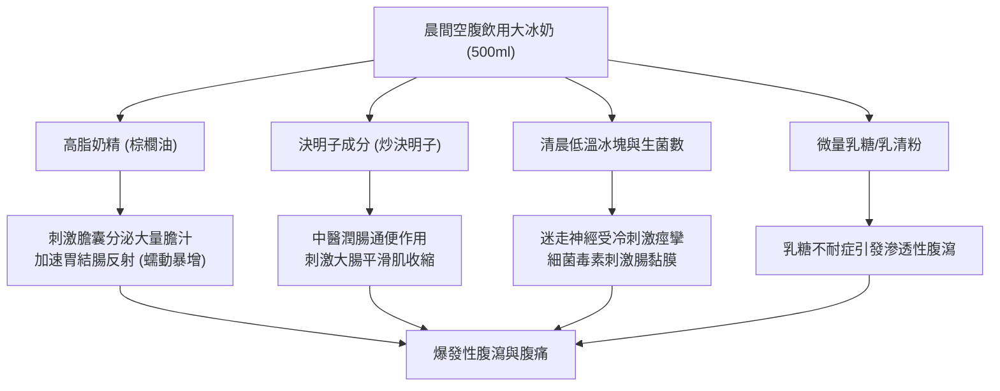

# 大冰奶致瀉機制與反式脂肪

## 生理與致瀉機制解析
台灣早餐店「大冰奶」在民間被稱為腸胃科通腸聖品，其致瀉並非單一原因，而是四重生理與成分協同刺激的結果：

## 營養與心血管風險
1. **反式脂肪與飽和脂肪**：
   - 傳統早餐店使用的 [[早餐店奶精]] 多為氫化或分餾棕櫚油，含有較高比例飽和脂肪與可能的微量工業反式脂肪，長期飲用顯著提高心血管疾病（LDL-C 升高、HDL-C 降低）與全身慢性發炎風險。
2. **液體高果糖糖漿**：
   - 單杯 500ml 大冰奶平均含糖量達 35~45 公克（等同 8 顆方糖），液體糖直接被肝臟轉化為內臟脂肪。

## 替代與改裝建議
* 告別奶精：改點無糖鮮奶茶（紅茶拿鐵）或 [[無糖高纖豆漿]]。

## 相關實體
* 實體品項：[[大冰奶]]、[[古早味紅茶]]
* 實體原料：[[早餐店奶精]]
